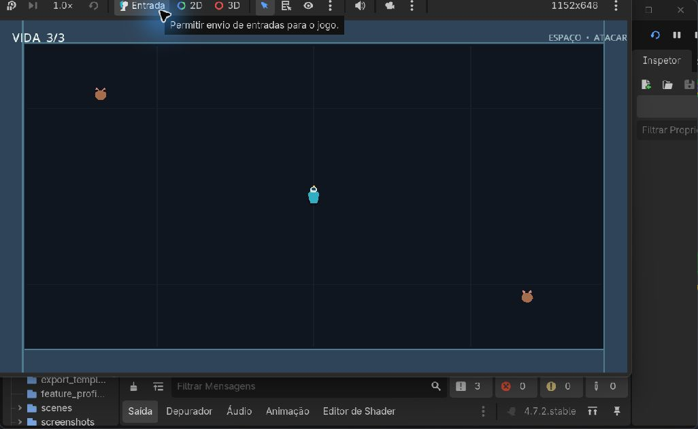

# Resgate Estelar

Projeto de Jogos Digitais II. O jogo está sendo construído por etapas, conforme o conteúdo de cada aula.

## Carta do jogo

- **Tema:** nave de carga infestada por ratos espaciais.
- **Tipo:** Resgate.
- **Modo:** horda, arena vista de cima.
- **Objetivo:** encontrar cinco aliados, que passam a seguir o jogador em fila, e sobreviver.
- **Vitória:** resgatar os cinco aliados.
- **Derrota:** perder toda a vida ou deixar um rato alcançar a fila.

Esses objetivos descrevem o projeto completo. A Aula 08 entregou a arena e o movimento. Na Aula 09, o primeiro checkpoint acrescentou vida, ratos perseguidores e ataque; o segundo acrescenta aliados seguidores, contagem de resgates e condições de vitória e derrota. O desvio dos ratos ao redor de obstáculos fica para uma etapa posterior.

## Controles atuais

- **Mover:** setas ou `W`, `A`, `S`, `D`.
- **Atacar:** `Espaço`.
- **Reiniciar depois da derrota:** `Enter`.

## Como abrir

1. Abra o Godot 4.7.
2. Importe o arquivo `project.godot` desta pasta.
3. Execute o projeto com **F6** para testar a cena aberta ou **F5** para iniciar a cena principal.

## Captura do primeiro checkpoint da Aula 09

