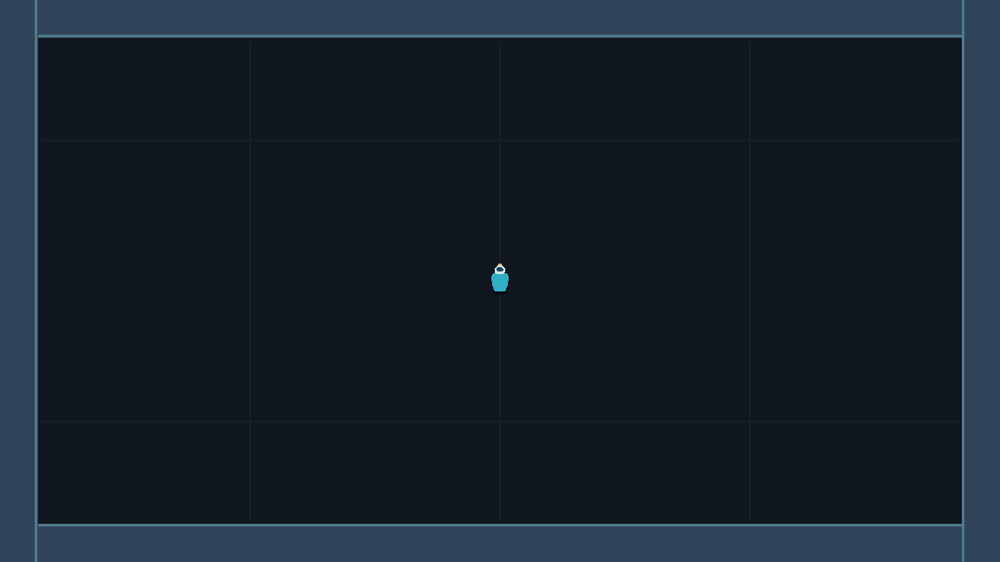

# Resgate Estelar

Projeto de Jogos Digitais II. A primeira etapa implementa a arena da Aula 08 e o movimento básico do personagem.

## Carta do jogo

- **Tema:** nave de carga infestada por ratos espaciais.
- **Tipo:** Resgate.
- **Modo:** horda, arena vista de cima.
- **Objetivo:** encontrar cinco aliados, que passam a seguir o jogador em fila, e sobreviver.
- **Vitória:** resgatar os cinco aliados.
- **Derrota:** perder toda a vida ou deixar um rato alcançar a fila.

Esses objetivos descrevem o projeto completo. Neste primeiro marco, ainda estão implementados somente a arena fechada e o movimento do personagem.

## Controles atuais

- **Mover:** setas ou `W`, `A`, `S`, `D`.

## Como abrir

1. Abra o Godot 4.7.
2. Importe o arquivo `project.godot` desta pasta.
3. Execute o projeto com **F6** para testar a cena aberta ou **F5** para iniciar a cena principal.

## Captura da arena

