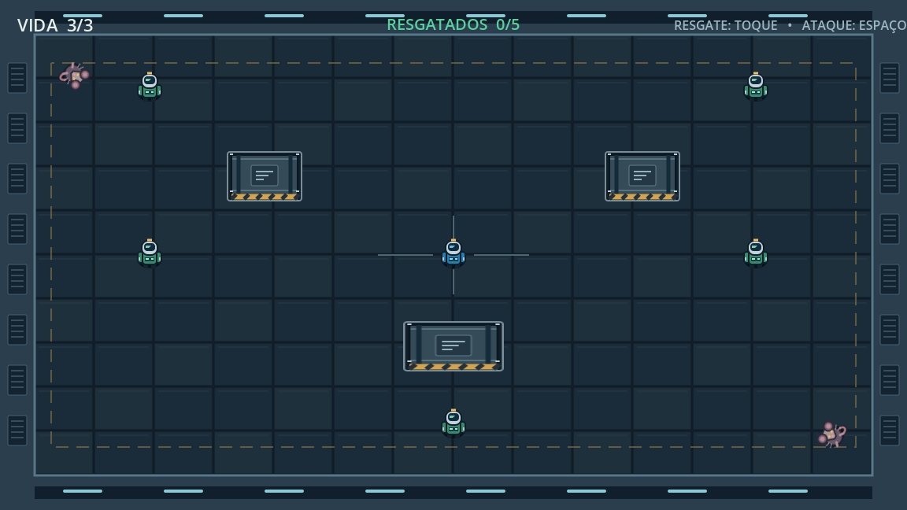

# Resgate Estelar

Este é meu projeto de Jogos Digitais II. Vou acrescentando uma parte do jogo a cada aula.

[Jogue Resgate Estelar no navegador](https://eduardopiresbianchi.itch.io/resgate-estelar)

## Carta do jogo

- Tema: uma nave de carga infestada por ratos espaciais.
- Tipo: resgate.
- Modo: horda, com a arena vista de cima.
- Objetivo: encontrar cinco aliados. Depois de resgatados, eles seguem o jogador em fila.
- Vitória: resgatar os cinco aliados.
- Derrota: ficar sem vida ou deixar um rato alcançar a fila.

Na Aula 08, montei a arena e programei o movimento. Na Aula 09, adicionei vidas, ataque e resgate. Na Aula 10, coloquei caixas de carga e ajustei os ratos para desviar delas.

Na Aula 11, desenhei a nave, as caixas e os personagens e aumentei a horda para até 24 ratos. O traje do jogador é azul e o dos aliados, verde. Eles viram quando andam; depois de levar dano, o jogador pisca por um instante.

## Controles

As setas ou `W`, `A`, `S`, `D` movem o personagem. Use `Espaço` para atacar e `Enter` para reiniciar depois do fim da partida.

## Como abrir

1. Abra o Godot 4.7.
2. Importe o arquivo `project.godot` desta pasta.
3. Aperte **F5** para iniciar a partida. **F6** executa a cena selecionada.

## Arte e autoria

Desenhei os SVGs da nave, da caixa, do jogador, do aliado e do rato com ajuda do ChatGPT. Nesta etapa, não usei arte, fontes ou sons de outras pessoas. Os scripts que fiz com ajuda do ChatGPT têm essa informação no começo do arquivo.

## Captura da Aula 11

